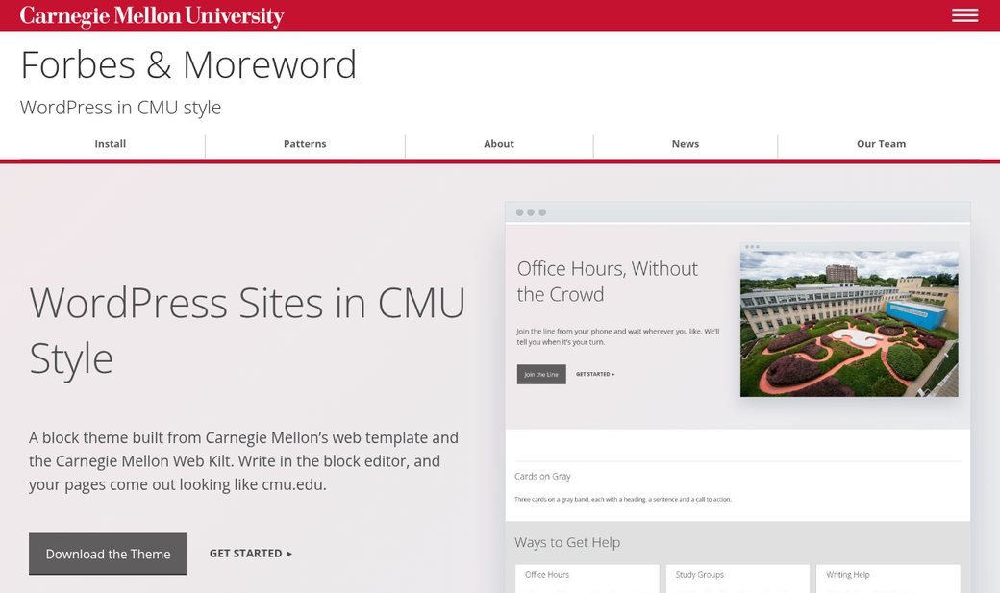

# Forbes & Moreword

A WordPress block theme for Carnegie Mellon websites, built from Carnegie
Mellon's web template and the [Carnegie Mellon Web
Kilt](https://webkilt.andrew.cmu.edu/). Write in the block editor, and your
pages match the rest of cmu.edu. It's named for the corner of Forbes and
Morewood. Same intersection, more words.

Docs: https://forbesandmoreword.andrew.cmu.edu/



## Install

1. Download [`forbes-and-moreword.zip`](https://github.com/cmu-web/cmu-web-forbes-and-moreword/releases/latest/download/forbes-and-moreword.zip), the latest release.
2. In WordPress, select **Appearance › Themes › Add New Theme › Upload
   Theme**, choose the file and select **Install Now**.
3. Select **Activate**.

It works on WordPress 6.6 or later, with PHP 8.1 or later. Visitors'
browsers load CMU's template from www.cmu.edu and the kit from jsDelivr.

## What You Get

| In WordPress | On the Page |
| --- | --- |
| Every page | CMU's roof, the site's name, tabs for its pages and the footer |
| Site title and tagline | The name at the top and the line under it |
| Site Logo | Your unit's official logo, to the right of the name |
| Posts | The kit's Article at the top: category, date, headline, summary and byline |
| Latest Posts block, and the News page | The template's News Grid: a picture, the date, the title and a sentence for each story |
| Appearance › Customize › Link Previews | The Preview Image, for link previews in Slack, Teams and social sites |
| The Full-Width Sections page template | A page made of full-width sections, like the kit's home pages |
| Patterns, under Carnegie Mellon Web Kilt | FAQ, Text Section, Cards on Gray, Leadership Team, Callout and Numbered Steps |
| Button styles | Button, Ghost Button and Call to Action |
| Heading style | With a Line, for section headings |
| Header template parts | A red, gray or white roof |


## How It Works

The theme adds no CSS of its own. Its look comes from CMU's template and
the kit, loaded in `functions.php`; the kit is pinned to one release with
subresource integrity, so a changed file is refused. To make the template's
styles and script work, `functions.php` also turns a few blocks into the
template's markup:

- Buttons become the template's `btn`, `btn ghost` and `cta` links. A button
  that links to a file, such as a `.zip` or `.pdf` or a GitHub release
  download, becomes a download link (`download` and `data-cmu-download`), so
  the kit's script can say "Downloaded" after a click.
- The post content goes into the page without WordPress's wrapper, since the
  template lays out the page's sections by their place in the page.
- The site's name and tagline become the template's `#sitename`, with the
  logo, if there is one, linked right after them.
- A post's top becomes the kit's Article, written from the post's category,
  date, hand-written excerpt and author.
- Every page but the home page starts with the template's breadcrumbs: the
  site's name, the page's parent pages (or News, for a post), then the page.
- The Latest Posts block and the News page's Query Loop become the
  template's News Grid, three stories to a row. The block's settings still
  work: how many stories, the categories, author and order, and whether to
  show each story's featured image, date ("Monday, Nov. 16, 2026") and
  sentence. Put the block in a group with the `grid column3 news` class, after
  a level 1 heading, to give the grid a heading; a paragraph with
  `cmu-grid-full` after it, such as a link to all the news, runs across the
  grid. When no story has a picture, the stories show without one; when some
  do, the rest get the template's gray picture box, so the rows line up.
- Dates in other lists of posts follow AP style, as the Article's does:
  Nov. 15, 2026.
- The navigation is the site's menu (**Appearance › Editor › Navigation**),
  so a tab's label needn't match its page's title and a tab can link
  anywhere. It's written as the template's own list, with the current tab
  marked and the home page left out. With no menu yet, it lists the pages.
- The footer's copyright line keeps the current year.
- Pages render without WordPress's `wp-site-blocks` wrapper (`canvas.php`),
  so the template's menu opens.
- The kit's `cmu-app.css` loads on every page, with `cmu-app` on the body,
  so forms (comments, search, plugins' forms), flash messages and the pager
  get the kit's styles.
- Every page gets link preview tags, following the kit's Link Previews
  standard: "Page - Site" as the title, the page's excerpt (or its opening
  words) as the description, and a picture. A post with a featured image uses
  it; everything else uses the Preview Image you choose under **Appearance ›
  Customize › Link Previews**, a JPEG, 1200 × 630 pixels and under 300 KB.
  When Yoast SEO, Rank Math, All in One SEO, SEOPress or The SEO Framework is
  active, the theme writes none, since the plugin writes its own. The
  `fam_link_preview` filter changes any field.
- In the block editor, the template's font and styles and the kit's load
  too, and `editor.js` gives buttons, calls to action and headings with a line
  the template's look, read from the template's own styles.

The template uses WordPress's jQuery, including its global `$` alias, instead
of loading another version. Button conversions preserve link settings,
anchors and accessibility attributes.

## Known Gaps

- In the block editor, the Latest Posts block shows WordPress's own list;
  the page shows the News Grid.
- No dark mode, search or comments.

## The Docs Site

forbesandmoreword.andrew.cmu.edu runs this theme. Everything on it comes
from `site/`: `seed.sh` builds it with WP-CLI on an empty database, from
the pages in `site/pages/`, the News posts in `site/posts/`, the images in
`site/images/` and the site's own footer and 404 in `site/parts/` and
`site/templates/`. Files in `site/static/images/` (the street sign artwork and
the link preview images) are served as they are, at `/images/`. To change the
site, change those files. Nobody signs in: `site/mu-plugins/` refuses every
sign-in and turns off application passwords, XML-RPC and the REST API's user
list.

The hosted site is one image, built by the `Dockerfile`: WordPress with Apache,
the theme and the site, seeded into a SQLite database when the image is built.
The container runs with a read-only root filesystem as `www-data`; at start it
copies the database into `/tmp`, so a restart puts the site back as built. It
answers 404 for the admin, sign-in, XML-RPC and REST paths. To try it:

    docker build -t forbes-and-moreword .
    docker run --rm --read-only --tmpfs /tmp --cap-drop=ALL \
      --security-opt no-new-privileges -p 127.0.0.1:3804:8080 \
      -e FAM_URL=http://127.0.0.1:3804 forbes-and-moreword
    docker/check.sh http://127.0.0.1:3804

The site demonstrates the theme through its own pages: a silent video hero,
full-width sections, cards and a live news feed. Installation instructions
and the agent setup prompt live on Install. A video hero loads YouTube's
player and the template's video script only on pages that use one; its
photo remains visible on phones and when the video cannot play.

To run a copy on your computer, with made-up posts by Andrew Carnegie,
Margaret Morrison and Andrew Mellon and a placeholder logo, you need Docker:

    dev/run.sh up       # http://127.0.0.1:3800/
    dev/run.sh down

For screenshots of the block editor, `dev/run.sh editor` gives the local
copy's admin account a demo password. It works only at 127.0.0.1 or
localhost, with a setting only `dev/compose.yml` turns on.

With the local site running, `dev/run.sh check` checks the actual WordPress
block rendering, link settings, script dependencies, navigation and Article
markup. To check desktop and mobile pages in Chromium:

```sh
npm ci
npx playwright install chromium
npm run test:browser
```

Or, with nothing to install but Docker, `dev/run.sh browser` runs the same
check in Playwright's image, as your user, so its screenshots stay yours.

The browser check exercises the mobile menu, the News Grid, a plugin attached
to WordPress's jQuery and the agent prompt's copy button. It saves screenshots
in `test-results/` (or the folder in `FAM_TEST_RESULTS`) and uses gray
fixtures for PlaceMellon images. CI runs both
sets of checks on WordPress 6.6 and 7.0.4 and compares the kit integrity hashes
with the pinned release's manifest.

## Release

Push a version tag, such as `0.1.0`, that matches `Version:` in
`forbes-and-moreword/style.css`. The
[release workflow](.github/workflows/release.yml) zips the theme and
attaches `forbes-and-moreword.zip` to the tag's GitHub release, and the
[publish workflow](.github/workflows/publish.yml) pushes the docs site's image
to `ghcr.io/cmu-web/cmu-web-forbes-and-moreword`. The fleet pins the image by
digest.

## License

Copyright Carnegie Mellon University. The code and documentation use the
[BSD 3-Clause License](LICENSE). CMU's names, marks and Scotty artwork are
not covered by that license, and CMU's web template is separate from this
repository.
