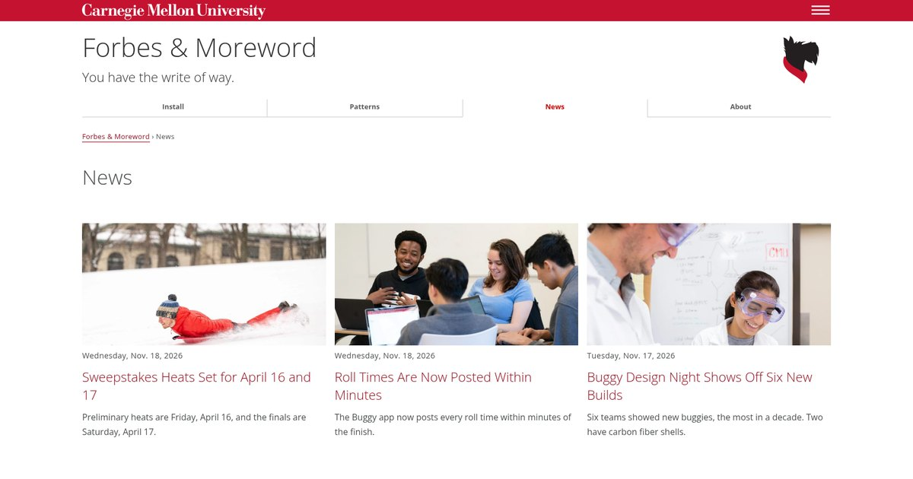
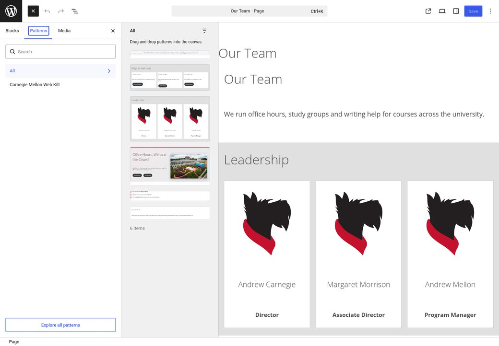

# Forbes & Moreword

Forbes & Moreword, named for the corner of Forbes and Morewood, is a
WordPress block theme for Carnegie Mellon websites, built from Carnegie
Mellon's web template and the [Carnegie Mellon Web
Kilt](https://webkilt.andrew.cmu.edu/). Write in the block editor, and your
pages match the rest of cmu.edu.

Docs: https://themes.andrew.cmu.edu/forbes-and-moreword/

## Install

Download `forbes-and-moreword.zip` from the
[latest release](https://github.com/cmu-web/cmu-web-forbes-and-moreword/releases/latest)
and upload it under **Appearance › Themes** in WordPress 6.6 or later, with
PHP 8.1 or later. [Deployment](DEPLOYMENT.md#install) has the steps.

## What You Get

| In WordPress                             | On the Page                                                                            |
| ---------------------------------------- | -------------------------------------------------------------------------------------- |
| Every page                               | CMU's roof, the site's name, tabs for its pages and the footer                         |
| Site title and tagline                   | The name at the top and the line under it                                              |
| Site Logo                                | Your unit's official logo, to the right of the name                                    |
| Posts                                    | The kit's Article at the top: category, date, headline, summary and byline             |
| Latest Posts block, and the News page    | The template's News Grid: a picture, the date, the title and a sentence for each story |
| Appearance › Customize › Link Previews   | The Preview Image, for link previews in Slack, Teams and social sites                  |
| The Full-Width Sections page template    | A page made of full-width sections, like the kit's home pages                          |
| Patterns, under Carnegie Mellon Web Kilt | FAQ, Text Section, Card Grid, Leadership Team, Callout and Numbered Steps              |
| Button styles                            | Button, Ghost Button and Call to Action                                                |
| Heading style                            | With a Line, for section headings                                                      |
| Header template parts                    | A red, gray or white roof                                                              |

## Known Gaps

- In the block editor, the Latest Posts block shows WordPress's own list;
  the page shows the News Grid.
- No dark mode, search or comments.
